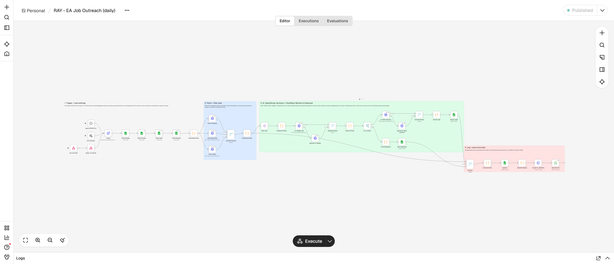

# Task 1 – Executive Assistant Job Outreach Automation

[](https://github.com/benjaminkariuki/ray-ai-automation-case-study/actions/workflows/health-check.yml)

An **n8n workflow** runs every day and does four things:

1. Finds new Executive Assistant and Admin Assistant jobs on three job boards. LinkedIn is not used.
2. Uses AI to check that each job is **remote, English-speaking and relevant**.
3. Writes a **personalised outreach email** for every job that passes.
4. Saves everything to a **Google Sheet that sales reps use as their dashboard**.

| | |
|---|---|
| **Google Sheet (dashboard)** | https://docs.google.com/spreadsheets/d/1GwAt8R3_O-h6ivZ_CT_8yD6GMIdybyf2-YgscTQ9hRI |
| **n8n workflow export** | [workflow/job-outreach-workflow.json](workflow/job-outreach-workflow.json) |
| **Sample output** | [sample-output/](sample-output/) (CSV for each tab, plus the full JSON of one run) |
| **Test report** | [docs/TEST_REPORT.md](docs/TEST_REPORT.md) |
| **Daily health check** | [GitHub Actions](https://github.com/benjaminkariuki/ray-ai-automation-case-study/actions/workflows/health-check.yml) |



---

## 1. For evaluators: verify it in 5 minutes

| # | What to check | How |
|---|---|---|
| 1 | **Populated Sheet** | Open the Sheet → **Leads** tab. It has the 6 required columns in order, then extra tracking columns. |
| 2 | **Validation works** | **Rejected** tab: each rejected job shows Yes/No for Remote, English, Relevant and Agency, plus the AI's reason. |
| 3 | **Personalised messages** | Compare 2–3 messages in **Leads** with their **Job Posting URL**. Each one cites duties or details from that specific posting. |
| 4 | **Interchangeable prompt** | **Prompts** tab: two outreach prompts, `v1_warm` and `v2_direct`. The **Prompt Used** column in Leads shows both were used, switched from the Settings tab with no workflow change. |
| 5 | **Scheduling** | **Run Log** tab: one row per run, with a **Trigger** column (Schedule, Manual or Run-now link). The workflow runs daily at 06:00 UTC. |
| 6 | **Run it yourself** | Open the **Run-now link** from the submission PDF. After about 3 minutes, a new row appears in **Run Log**, plus any new jobs in Leads or Rejected. |
| 7 | **Automated check** | `python scripts/verify_sheet.py` checks the live Sheet against every requirement. It needs no login or packages; see the example below. The same check runs daily in GitHub Actions (see the badge above). |

```text
$ python scripts/verify_sheet.py
  [PASS] Required columns, in order: Job Posting URL, Job Title, Company Name, Location, Job Description, LLM-Generated Outreach Message
  [PASS] No empty required fields / No duplicate jobs / Compliant non-LinkedIn sources: Himalayas, Jobicy
  [PASS] Messages are unique / Messages reference the specific posting
  [PASS] Prompt is interchangeable (tracked per lead): prompts used: v1_warm, v2_direct
  [PASS] AI provider recorded per lead: providers: Cloudflare, OpenRouter
  [PASS] Every rejection failed a check / Automation ran in the last 30 hours / Latest run healthy
12/12 checks passed.
```

### Where each deliverable is
| Deliverable (from the brief) | Location |
|---|---|
| Source code: **scrape** | The *Fetch Himalayas / RemoteOK / Jobicy* nodes, plus [02_normalize_filter.js](workflow/code/02_normalize_filter.js) |
| Source code: **validate** | [validation_prompt.md](prompts/validation_prompt.md), [03_prepare_ai_check.js](workflow/code/03_prepare_ai_check.js) and [04_parse_ai_check.js](workflow/code/04_parse_ai_check.js) |
| Source code: **LLM** | [outreach_v1_warm.md](prompts/outreach_v1_warm.md), [outreach_v2_direct.md](prompts/outreach_v2_direct.md) and [05_format_lead.js](workflow/code/05_format_lead.js). The AI calls are the *AI:* and *Backup AI:* nodes |
| Source code: **Sheets** | The *Read …* and *Add to …* Google Sheets nodes, plus [setup_sheet.py](scripts/setup_sheet.py), which builds and formats the Sheet |
| Full workflow | [job-outreach-workflow.json](workflow/job-outreach-workflow.json), generated by [build_workflow.py](scripts/build_workflow.py) from the files in `workflow/code/` |
| Sample data output | [leads.csv](sample-output/leads.csv), [rejected.csv](sample-output/rejected.csv), [run-log.csv](sample-output/run-log.csv) and [job-run-sample.json](sample-output/job-run-sample.json) (every scraped posting and AI decision from one run) |
| Scheduling setup | The n8n *Daily at 06:00 UTC* trigger (section 5) |
| README | This file |
| Populated Google Sheet | The link at the top |

---

## 2. How it works

| Step | What happens |
|---|---|
| **1. Trigger + settings** | Starts daily at 06:00 UTC, from the n8n **Execute** button, or from the **Run-now link**. Loads settings, prompts and already-processed URLs from the Google Sheet. |
| **2. Fetch + filter** | Calls the public APIs of **Himalayas** (search), **RemoteOK** (assistant tag) and **Jobicy** (Admin & Support). Converts every job to one format: title, company, location, description, URL and date. Removes jobs with the wrong title keywords, excluded companies, postings older than 30 days, and duplicates. |
| **3. AI check** | LLM call 1 returns strict JSON: `is_remote`, `is_english`, `is_relevant`, `is_agency`, `language_requirements` and a `reason`. A job is kept only if **all three** checks pass and it isn't a staffing or VA agency. |
| **4. AI outreach** | LLM call 2 writes a short email based on that specific posting, using the prompt chosen in the Sheet. |
| **5. Save + log** | Matches go to **Leads**. Rejections go to **Rejected** with the reason. **All done** waits for every write, then adds a **Run Log** row and saves the full run as JSON. |

### AI providers and how failover works
```
OpenRouter (primary: Nemotron 3 Ultra, then Gemma 4 as its own fallback)
   └─ fails or hits its daily limit ──► Cloudflare Workers AI (backup: gpt-oss-120b)
                                          └─ also fails ──► job not saved; retried automatically next run
```
- Both providers are free tiers. OpenRouter allows about 50 requests a day; Cloudflare allows about 10,000 "neurons" a day, roughly 70 jobs.
- Each lead and rejection records the **AI Model** that answered. The Run Log counts **Backup AI Used**.
- An incomplete AI answer (missing fields or no reason) counts as an error, never a rejection, so a good job is never silently dropped.

### Built-in safeguards
- **No duplicates.** A job already in Leads or Rejected is never processed again, so the AI never gets paid to re-check it.
- **Cost cap.** `max_jobs_per_run` limits how many jobs go to the AI in one run.
- **Fault-tolerant sources.** If one job board fails, the others still run.
- **Health monitoring.** A daily GitHub Actions check pings the server and re-verifies the Sheet. A failure turns the badge red and emails the repo owner.
- **Self-recovery.** The server restarts n8n automatically after a reboot, and HTTPS certificates renew automatically.

---

## 3. For sales reps: using the Sheet

1. Open **Leads** and filter **Status = New**.
2. Open the **Job Posting URL** and read the draft in **LLM-Generated Outreach Message**. Edit it if needed.
3. Send it from your own email, then set **Status → Contacted**.
4. Keep the status up to date: **Replied**, **Meeting Booked** or **Not a Fit**. Use **Notes** for context.

| Tab | Purpose |
|---|---|
| How to Use | One-page guide inside the Sheet |
| **Leads** | Your dashboard: the 6 required columns, then Language Requirements, Source, Date Posted, Date Found, Prompt Used, AI Model, **Status** (a dropdown) and Notes |
| Rejected | Jobs the AI filtered out, with Yes/No for each check and the reason |
| Settings | Search terms, filters, AI models and sender details |
| Prompts | The AI instructions, as plain text |
| Run Log | One row per run: trigger, fetched, filtered, checked, added, rejected, errors and backup use |

> Don't delete rows in Leads or Rejected; the automation uses them to avoid duplicates. Use **Not a Fit** instead. Deleting a row deliberately makes the job get re-checked.


---

## 4. Changing filters and the AI prompt (no n8n needed)

Everything you'd want to tune is in the Google Sheet. Changes apply on the **next run**.

| Setting | Default | Effect |
|---|---|---|
| `search_queries` | executive assistant, administrative assistant, … | Searches sent to Himalayas |
| `himalayas_pages_per_query` | 3 | Result pages per search (20 jobs each) |
| `title_include_keywords` | executive assistant, office administrator, … | A title must contain at least one of these |
| `title_exclude_keywords` | medical, dental, sales, engineer, … | Titles containing these are skipped |
| `excluded_companies` | Wing Assistant, Hire Overseas, … | Never contact these companies (competitors, agencies) |
| `exclude_agencies` | TRUE | Also drop jobs the AI identifies as staffing or VA agencies |
| `max_posting_age_days` | 30 | Ignore older postings |
| `max_jobs_per_run` | 15 | Maximum new jobs sent to the AI per run |
| `validation_model` / `outreach_model` / `fallback_model` | Nemotron 3 Ultra / Nemotron 3 Ultra / Gemma 4 (`:free`) | OpenRouter models ([list](https://openrouter.ai/models)) |
| `backup_model` | `@cf/openai/gpt-oss-120b` | Cloudflare model ([list](https://developers.cloudflare.com/workers-ai/models/)) |
| `outreach_prompt` | v1_warm | Which row of the Prompts tab writes the messages |
| `sender_name`, `sender_company`, `sender_offer`, `call_to_action` | | Who the message is from, and the only facts the AI may state about us |

**To test a new tone:**
1. Add a row to **Prompts**, for example `v3_short`.
2. Set **Settings → outreach_prompt** to `v3_short`.
3. Each new lead records the **Prompt Used**, so you can compare results by prompt.

Available placeholders: `{{job_title}}`, `{{company_name}}`, `{{location}}`, `{{job_description}}`, `{{language_requirements}}`, `{{sender_name}}`, `{{sender_company}}`, `{{sender_offer}}` and `{{call_to_action}}`.

---

## 5. Install, run and schedule

### What you need
- **n8n** version 2.x: n8n Cloud or self-hosted. Option B below sets up a ready-made server.
- **Google Cloud service account** with the Sheets API and Drive API enabled.
- **OpenRouter API key** from https://openrouter.ai/settings/keys. A free account works.
- **Cloudflare account ID and an API token** made from the *Workers AI* template at https://dash.cloudflare.com/profile/api-tokens. A free account works.

### Option A: use an existing n8n
1. **Create the Sheet.** Create a blank Google Sheet and share it as **Editor** with the service-account email. Then run:
   ```bash
   cd scripts && pip install -r requirements.txt
   python setup_sheet.py --sheet-id <SHEET_ID> --key <service-account.json>
   ```
   This creates every tab, header, dropdown and default setting. It's safe to re-run, and it adds new columns to older Sheets automatically.
2. **Import the workflow.** In n8n, go to **Workflows → Import from file** and choose `workflow/job-outreach-workflow.json`.
3. **Add three credentials:**
   - **Google Sheets:** Google API (Service Account) credential.
   - **OpenRouter:** Header Auth, Name `Authorization`, Value `Bearer <OpenRouter key>`.
   - **Cloudflare:** Header Auth, Name `Authorization`, Value `Bearer <Cloudflare token>`.

   Select them in the Google Sheets nodes, the *AI:* nodes and the *Backup AI:* nodes respectively.
4. **Fill in the Config node:** paste your **Sheet ID** and **Cloudflare account ID**.
5. **Test.** Click **Execute workflow**, then check the Leads, Rejected and Run Log tabs.
6. **Schedule it.** Click **Publish**. The workflow then runs daily at 06:00 UTC and the Run-now link becomes active.

### Option B: deploy your own server (Azure)
[deploy/deploy-azure.sh](deploy/deploy-azure.sh) creates an Ubuntu VM with Docker, n8n 2.47.2 and Caddy for automatic HTTPS. SSH access is limited to your IP address.
```bash
az login
bash deploy/deploy-azure.sh my-n8n-name     # → https://my-n8n-name.southafricanorth.cloudapp.azure.com
```
Open the URL, create the owner account, then follow option A from step 2. The 4 GB VM costs about $30 a month; n8n is unreliable on 1 GB.

### Day-to-day
| Task | How |
|---|---|
| Run now | **Execute workflow** in n8n, or open the Run-now link (`/webhook/<path>` from the *Run now (link)* node) |
| Change the schedule | Open the **Daily at 06:00 UTC** node, change the hour or frequency (for example weekly), then **Publish** |
| Pause | **Unpublish** |
| History | The n8n **Executions** tab, the Sheet's **Run Log**, and JSON files in `/opt/n8n/files/` on the server |
| Edit Code nodes | Edit `workflow/code/*.js`, then run `python scripts/build_workflow.py` to regenerate the workflow JSON |

---

## 6. Troubleshooting

| Symptom | Cause | Fix |
|---|---|---|
| **Backup AI Used** > 0 in the Run Log | OpenRouter rate-limited or down | Nothing to do: Cloudflare covered it. If it happens every day, add $10 OpenRouter credit (raises the limit from 50 to 1,000 requests a day) |
| **LLM Errors** > 0 | Both AI providers failed, or a reply was incomplete | Nothing to do: those jobs retry next run. If it persists, change `backup_model` |
| Checked by LLM = 0 | No *new* matching jobs (all already seen) | Normal on quiet days. Broaden `search_queries` or the keywords, or raise `himalayas_pages_per_query` |
| Good job in **Rejected** | AI judged it non-remote, non-English or an agency | Read the Reason. Adjust the `validation` prompt or settings, then delete the row to have it re-checked |
| *"outreach_prompt is … but no row with that Prompt Name exists"* | Typo in Settings | Use the exact Prompt Name from the Prompts tab |
| Google Sheets *403/404* | Sheet not shared with the service account, or wrong ID in Config | Share as Editor and check the ID |
| OpenRouter or Cloudflare *401* | Wrong or expired key | Update the credential (`Bearer …`) |
| Health-check badge is red | Server down, or no run in 30 hours | Open the failed Action to see which check failed. Check the VM is running in the Azure portal and that the workflow is **Published** |

---

## 7. Design decisions
- **Compliant sources.** Official public JSON APIs only: no HTML scraping and no LinkedIn. Each lead keeps the original URL and its source name, as the boards' terms ask.
- **Cheap filter first, AI second.** Keyword rules remove about 75–85% of postings before any AI call, so the workflow fits inside free AI tiers.
- **Two independent AI providers.** OpenRouter is primary and Cloudflare is the backup. Each lead records which model wrote it.
- **Agency detection.** Many remote EA postings come from VA and staffing agencies, which are competitors rather than leads. They're excluded by name and by the AI.
- **No made-up claims.** Facts about the company come only from the posting, and facts about us only from `sender_offer`. Testing caught and removed invented language skills and tool expertise.
- **Configuration in the Sheet.** Non-technical users can change search terms, filters, models and tone without opening n8n.

## 8. Repository layout
```
task1-job-outreach/
├── workflow/job-outreach-workflow.json   # import this into n8n
├── workflow/code/*.js                    # source of every Code node
├── prompts/*.md                          # default prompts (copied into the Sheet)
├── scripts/setup_sheet.py                # creates, formats and migrates the Google Sheet
├── scripts/build_workflow.py             # builds the workflow JSON from source
├── scripts/verify_sheet.py               # checks the live Sheet against the requirements
├── deploy/                               # Azure VM + Docker + HTTPS setup
├── sample-output/                        # leads.csv, rejected.csv, run-log.csv, job-run-sample.json
└── docs/                                 # TEST_REPORT.md + screenshots
```
