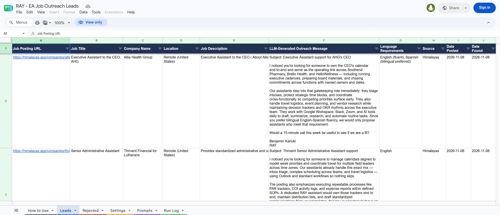

# Task 1 – Executive Assistant Job Outreach Automation

[](https://github.com/benjaminkariuki/ray-ai-automation-case-study/actions/workflows/job-outreach.yml)

A **Python pipeline, run every day by GitHub Actions**, does four things:

1. Finds new Executive Assistant and Admin Assistant jobs on three job boards. LinkedIn is not used.
2. Uses AI to check that each job is **remote, English-speaking and relevant**.
3. Writes a **personalised outreach email** for every job that passes.
4. Saves everything to a **Google Sheet that sales reps use as their dashboard**.

It runs on GitHub's servers, so there's no server of our own to keep alive.

| | |
|---|---|
| **Google Sheet (dashboard)** | https://docs.google.com/spreadsheets/d/1GwAt8R3_O-h6ivZ_CT_8yD6GMIdybyf2-YgscTQ9hRI |
| **Run history (public logs)** | https://github.com/benjaminkariuki/ray-ai-automation-case-study/actions/workflows/job-outreach.yml |
| **Source code** | [job_outreach/](job_outreach/) |
| **Schedule** | [.github/workflows/job-outreach.yml](../.github/workflows/job-outreach.yml) |
| **Sample output** | [sample-output/](sample-output/): a CSV of each Sheet tab, plus [latest/](sample-output/latest/), the newest run's JSON and CSV (updated automatically after every run) |
| **Test report** | [docs/TEST_REPORT.md](docs/TEST_REPORT.md) |

---

## 1. For evaluators: verify it in 5 minutes

| # | What to check | How |
|---|---|---|
| 1 | **Populated Sheet** | Open the Sheet → **Leads** tab. It has the 6 required columns in order, then extra tracking columns. |
| 2 | **Validation works** | **Rejected** tab: each rejected job shows Yes/No for Remote, English, Relevant and Agency, plus the AI's reason. |
| 3 | **Personalised messages** | Compare 2–3 messages in **Leads** with their **Job Posting URL**. Each one cites duties or details from that specific posting. |
| 4 | **Interchangeable prompt** | **Prompts** tab: two outreach prompts, `v1_warm` and `v2_direct`. The **Prompt Used** column in Leads shows both were used, switched from the Settings tab with no code change. |
| 5 | **Scheduling** | Open the **Run history** link above. There's a run every day at 06:00 UTC, and each run has a readable summary page and full console logs. The Sheet's **Run Log** tab records the same runs. |
| 6 | **Console and sample output** | Open any run → *Run the pipeline* for the console output. [sample-output/latest/](sample-output/latest/) holds the newest run's JSON (every scraped posting and AI decision) and CSV. |
| 7 | **Automated check** | `python scripts/verify_sheet.py` checks the live Sheet against every requirement. It needs no login or packages. It also runs automatically after every scheduled run. |

```text
$ python scripts/verify_sheet.py
  [PASS] Required columns, in order: Job Posting URL, Job Title, Company Name, Location, Job Description, LLM-Generated Outreach Message
  [PASS] Leads present / No empty required fields / No duplicate jobs
  [PASS] Compliant non-LinkedIn sources: Himalayas, Jobicy
  [PASS] Messages are unique / Messages reference the specific posting: 34/34
  [PASS] Prompt is interchangeable (tracked per lead): prompts used: v1_warm, v2_direct
  [PASS] AI provider recorded per lead: providers: Cloudflare, OpenRouter
  [PASS] Every rejection failed a check / Automation ran in the last 30 hours / Latest run healthy
12/12 checks passed.
```

### Where each deliverable is
| Deliverable (from the brief) | Location |
|---|---|
| Source code: **scrape** | [sources.py](job_outreach/sources.py) (Himalayas, RemoteOK and Jobicy APIs) and [filters.py](job_outreach/filters.py) |
| Source code: **validate** | [ai.py](job_outreach/ai.py) (`validate`, `parse_verdict`) and [validation_prompt.md](prompts/validation_prompt.md) |
| Source code: **LLM** | [ai.py](job_outreach/ai.py) (OpenRouter with Cloudflare backup, `write_outreach`, `format_message`), [outreach_v1_warm.md](prompts/outreach_v1_warm.md) and [outreach_v2_direct.md](prompts/outreach_v2_direct.md) |
| Source code: **Sheets** | [sheet.py](job_outreach/sheet.py) (reads settings, writes rows) and [setup_sheet.py](scripts/setup_sheet.py) (builds and formats the Sheet) |
| Orchestration | [pipeline.py](job_outreach/pipeline.py) runs the whole flow; [`__main__.py`](job_outreach/__main__.py) is the command line |
| Tests | [tests/](tests/) (offline unit tests run before every scheduled run) and [verify_sheet.py](scripts/verify_sheet.py) (live checks) |
| Sample data output | [sample-output/](sample-output/), and the console logs of each [run](https://github.com/benjaminkariuki/ray-ai-automation-case-study/actions/workflows/job-outreach.yml) |
| Scheduling setup | [job-outreach.yml](../.github/workflows/job-outreach.yml): GitHub Actions, daily at 06:00 UTC (section 5) |
| README | This file |
| Populated Google Sheet | The link at the top |

---

## 2. How it works

```
GitHub Actions (daily 06:00 UTC, or "Run workflow")
  └─ python -m job_outreach
       1. Read Settings + Prompts + already-processed URLs from the Google Sheet
       2. Fetch jobs: Himalayas (search) · RemoteOK (assistant tag) · Jobicy (Admin & Support)
       3. Filter: title keywords, excluded companies, max age, duplicates  (no AI cost)
       4. AI check per job → strict JSON: remote? English? relevant? agency? languages, reason
       5. AI outreach email for each job that passes all three (and isn't an agency)
       6. Write Leads + Rejected, then a Run Log row; save JSON/CSV of the run
  └─ verify_sheet.py re-checks the live Sheet; the run's output is committed to sample-output/latest/
```

### AI providers and how failover works
```
OpenRouter (primary: Nemotron 3 Ultra → Gemma 4 as its own fallback)
   └─ error, rate limit or unusable reply ──► Cloudflare Workers AI (backup: gpt-oss-120b)
                                                └─ also fails ──► job not saved; retried automatically next run
```
- Both providers are free tiers. OpenRouter allows about 50 requests a day; Cloudflare allows about 10,000 neurons a day, roughly 70 jobs.
- Each lead and rejection records the **AI Model** that answered. The Run Log counts **Backup AI Used**.
- An incomplete AI answer (missing fields or no reason) counts as an error, never a rejection, so a good job is never silently dropped.

### Built-in safeguards
- **No duplicates.** A job already in Leads or Rejected is never processed again, so the AI never gets paid to re-check it.
- **Cost cap.** `max_jobs_per_run` limits how many jobs go to the AI in one run.
- **Fault-tolerant sources.** If one job board fails, the others still run.
- **No server to maintain.** GitHub runs the job. Every run is tested first (offline unit tests) and checked afterwards (`verify_sheet.py`). If anything fails, the badge turns red and GitHub emails the repo owner.
- **The schedule never goes idle.** Each run commits its output, which keeps the repo active, so GitHub doesn't pause the schedule.

---

## 3. For sales reps: using the Sheet

1. Open **Leads** and filter **Status = New**.
2. Open the **Job Posting URL** and read the draft in **LLM-Generated Outreach Message**. Edit it if needed.
3. Send it from your own email, then set **Status → Contacted**.
4. Keep the status up to date: **Replied**, **Meeting Booked** or **Not a Fit**. Use **Notes** for context.

| Tab | Purpose |
|---|---|
| How to Use | One-page guide inside the Sheet |
| **Leads** | Your dashboard: the 6 required columns, then Language Requirements, Source, Date Posted, Date Found, Prompt Used, AI Model, **Status** (a dropdown) and Notes |
| Rejected | Jobs the AI filtered out, with Yes/No for each check and the reason |
| Settings | Search terms, filters, AI models and sender details |
| Prompts | The AI instructions, as plain text |
| Run Log | One row per run: trigger, fetched, filtered, checked, added, rejected, errors and backup use |

> Don't delete rows in Leads or Rejected; the automation uses them to avoid duplicates. Use **Not a Fit** instead. Deleting a row deliberately makes the job get re-checked on the next run.



---

## 4. Changing filters and the AI prompt (no code needed)

Everything you'd want to tune is in the Google Sheet. Changes apply on the **next run**.

| Setting | Default | Effect |
|---|---|---|
| `search_queries` | executive assistant, administrative assistant, … | Searches sent to Himalayas |
| `himalayas_pages_per_query` | 3 | Result pages per search (20 jobs each) |
| `title_include_keywords` | executive assistant, office administrator, … | A title must contain at least one of these |
| `title_exclude_keywords` | medical, dental, sales, engineer, … | Titles containing these are skipped |
| `excluded_companies` | Wing Assistant, Hire Overseas, … | Never contact these companies (competitors, agencies) |
| `exclude_agencies` | TRUE | Also drop jobs the AI identifies as staffing or VA agencies |
| `max_posting_age_days` | 30 | Ignore older postings |
| `max_jobs_per_run` | 15 | Maximum new jobs sent to the AI per run |
| `validation_model` / `outreach_model` / `fallback_model` | Nemotron 3 Ultra / Nemotron 3 Ultra / Gemma 4 (`:free`) | OpenRouter models ([list](https://openrouter.ai/models)) |
| `backup_model` | `@cf/openai/gpt-oss-120b` | Cloudflare model ([list](https://developers.cloudflare.com/workers-ai/models/)) |
| `outreach_prompt` | v1_warm | Which row of the Prompts tab writes the messages |
| `sender_name`, `sender_company`, `sender_offer`, `call_to_action` | | Who the message is from, and the only facts the AI may state about us |

**To test a new tone:**
1. Add a row to **Prompts**, for example `v3_short`.
2. Set **Settings → outreach_prompt** to `v3_short`.
3. Each new lead records the **Prompt Used**, so you can compare results by prompt.

Available placeholders: `{{job_title}}`, `{{company_name}}`, `{{location}}`, `{{job_description}}`, `{{language_requirements}}`, `{{sender_name}}`, `{{sender_company}}`, `{{sender_offer}}` and `{{call_to_action}}`.

---

## 5. Install, run and schedule

### What you need
- **Python 3.10+**.
- **Google Cloud service account** with the Sheets API and Drive API enabled, and its JSON key.
- **OpenRouter API key** from https://openrouter.ai/settings/keys. A free account works.
- **Cloudflare account ID and an API token** made from the *Workers AI* template at https://dash.cloudflare.com/profile/api-tokens. A free account works.

### Setup (about 10 minutes)
```bash
git clone https://github.com/benjaminkariuki/ray-ai-automation-case-study.git
cd ray-ai-automation-case-study/task1-job-outreach
pip install -r requirements.txt
cp .env.example .env            # then fill in the 5 values (see the comments in the file)
```
1. **Create the Sheet.** Create a blank Google Sheet and share it as **Editor** with the service-account email (`client_email` in the key file).
2. **Build the tabs:**
   ```bash
   python scripts/setup_sheet.py --sheet-id <SHEET_ID> --key <service-account.json>
   ```
   This creates every tab, header, dropdown and default setting. It's safe to re-run.
3. **Test it:**
   ```bash
   python -m pytest -q tests                 # offline unit tests
   python -m job_outreach --dry-run          # full run, but nothing written to the Sheet
   python -m job_outreach                    # real run
   ```
   Options: `--max-jobs N` overrides the per-run cap.

### Scheduling with GitHub Actions
The schedule is in [.github/workflows/job-outreach.yml](../.github/workflows/job-outreach.yml).

1. Push the repo to GitHub.
2. Go to **Settings → Secrets and variables → Actions**.
3. Add a **variable** `SHEET_ID`, and 4 **secrets**:
   - `GOOGLE_SERVICE_ACCOUNT_JSON`: the key file's contents
   - `OPENROUTER_API_KEY`
   - `CLOUDFLARE_ACCOUNT_ID`
   - `CLOUDFLARE_API_TOKEN`

That's it. It runs daily at 06:00 UTC.

| Task | How |
|---|---|
| Run now | **Actions → Task 1 - EA Job Outreach → Run workflow**. Optional inputs: max jobs, dry run |
| Change the schedule | Edit `cron: "0 6 * * *"` in the workflow file, for example `"0 6 * * 1"` for weekly on Mondays |
| Pause | **Actions → the workflow → ••• → Disable workflow** |
| History | The **Actions** tab (logs and summary for each run), the Sheet's **Run Log**, and `sample-output/latest/` |
| Other schedulers | Any machine can run it with cron (`0 6 * * * cd /path/task1-job-outreach && python -m job_outreach`) or Windows Task Scheduler |

---

## 6. Troubleshooting

| Symptom | Cause | Fix |
|---|---|---|
| **Backup AI Used** > 0 in the Run Log | OpenRouter rate-limited or down | Nothing to do: Cloudflare covered it. If it happens every day, add $10 OpenRouter credit (raises the limit from 50 to 1,000 requests a day) |
| **LLM Errors** > 0 | Both AI providers failed, or a reply was incomplete | Nothing to do: those jobs retry next run. If it persists, change `backup_model` |
| Checked by LLM = 0 | No *new* matching jobs (all already seen) | Normal on quiet days. Broaden `search_queries` or the keywords, or raise `himalayas_pages_per_query` |
| Good job in **Rejected** | AI judged it non-remote, non-English or an agency | Read the Reason. Adjust the `validation` prompt or settings, then delete the row to have it re-checked |
| `outreach_prompt is "…" but the Prompts tab has no row with that name` | Typo in Settings | Use the exact Prompt Name from the Prompts tab |
| `SHEET_ID is not set` or a credentials message | Missing `.env` value or GitHub secret | Fill in `.env` locally, or add the secret or variable in GitHub |
| Google `PERMISSION_DENIED` / 404 | Sheet not shared with the service account, or wrong ID | Share as Editor and check the ID |
| `Tab 'Leads' is missing columns` | Sheet created by an older version | Re-run `scripts/setup_sheet.py`, which adds the columns |
| Badge is red / failure email | One of: tests, run or Sheet check failed | Open the failed run in **Actions**; the failing step and its log show why |

---

## 7. Design decisions
- **Compliant sources.** Official public JSON APIs only: no HTML scraping and no LinkedIn. Each lead keeps the original URL and its source name, as the boards' terms ask.
- **Cheap filter first, AI second.** Keyword rules remove about 75–85% of postings before any AI call, so the pipeline fits inside free AI tiers.
- **Two independent AI providers.** OpenRouter is primary and Cloudflare is the backup. Each lead records which model wrote it.
- **Agency detection.** Many remote EA postings come from VA and staffing agencies, which are competitors rather than leads. They're excluded by name and by the AI.
- **No made-up claims.** Facts about the company come only from the posting, and facts about us only from `sender_offer`. Testing caught and removed invented language skills and tool expertise.
- **Configuration in the Sheet.** Non-technical users can change search terms, filters, models and tone without touching code.
- **Serverless.** Python on GitHub Actions means no server, no hosting bill and public run history. An earlier version ran on self-hosted n8n; it was replaced so nothing depends on a server staying up (see the test report).

## 8. Repository layout
```
task1-job-outreach/
├── job_outreach/          # the Python package
│   ├── sources.py         #   scrape: Himalayas, RemoteOK, Jobicy APIs → one job format
│   ├── filters.py         #   keyword / company / age / duplicate filter
│   ├── ai.py              #   validate + outreach, OpenRouter → Cloudflare failover, parsing, formatting
│   ├── sheet.py           #   Google Sheets read/write
│   ├── pipeline.py        #   the end-to-end run, JSON/CSV output, GitHub run summary
│   └── __main__.py        #   command line
├── prompts/*.md           # default prompts (copied into the Sheet's Prompts tab)
├── scripts/setup_sheet.py # creates, formats and migrates the Google Sheet
├── scripts/verify_sheet.py# checks the live Sheet against the requirements (no login needed)
├── tests/                 # offline unit tests (filtering, parsing, formatting, failover)
├── sample-output/         # Sheet exports + latest/ (newest run, committed automatically)
├── docs/                  # TEST_REPORT.md + screenshots
├── requirements.txt
└── .env.example
```
